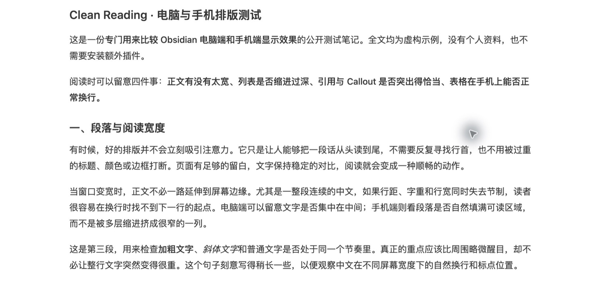
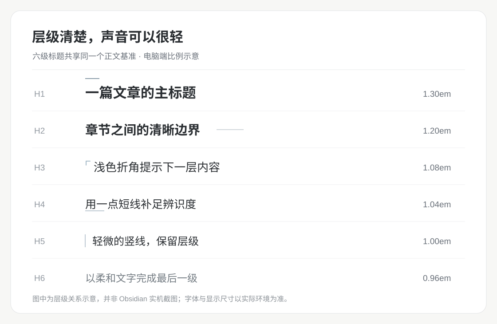
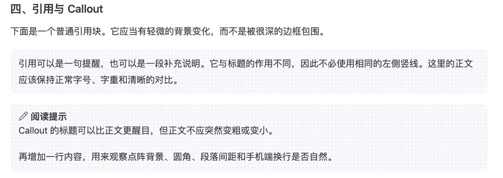
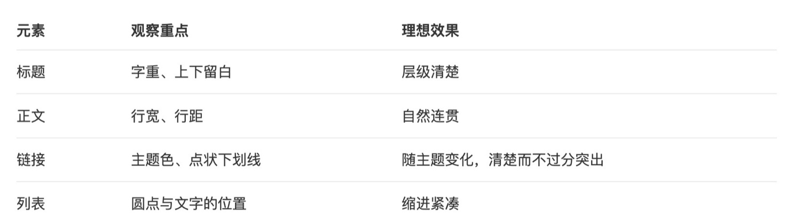

# Clean Reading

**让界面退后，让阅读发生。**

Clean Reading 是一份为 Obsidian 长文阅读设计的 CSS 片段。它关心的不是给每个元素增加存在感，而是让文字、结构与必要的提示各得其所：正文足够舒展，标题清楚但克制，颜色只在有信息价值的地方出现。浅色与深色界面遵循同一套阅读逻辑。

*Obsidian 实机阅读视图：一列适合持续阅读的正文，比占满整个窗口更重要。*

[下载 CSS](clean-reading.css) · [设计取舍](#设计取舍) · [字号速览](#字号速览) · [安装](#安装)

## 设计取舍

### 1. 先确定一行文字应该有多长

阅读界面最容易被忽略的变量，是**视线每次折返的距离**。行太长，读完一行后需要重新寻找下一行的起点；行太窄，频繁换行又会切碎句子的节奏。好的阅读宽度不是尽可能利用屏幕，而是让目光有一个稳定、可预期的移动范围。

在电脑上，阅读列以当前面板宽度的约 **65%** 为目标居中，最大 **820px**；宽度不足时优先确保正文仍有空间。手机端则尊重有限的屏幕宽度，减少多余的外边距与列表缩进。

正文以 **15px、400 字重、1.8 倍行距**为起点。段落之间有足够的间隔，连续中文不必靠加粗或颜色分段。字体交给 Obsidian 的正文字体设置：一套阅读样式应该安排节奏，而不是替读者规定字体偏好。

### 2. 标题是路标，不是海报

标题的职责是回答“我读到哪里了”，而不是不断吸引视线。过大的字号、通栏底线或高对比度的装饰，会让每次进入新章节都像一次视觉中断。

层级不仅靠大小，也靠**各自明确而轻巧的识别方式**。H1 上方的一段短线是文章的起笔，H2 则用字号、字重和上下留白提示章节转换，不需要额外横线。两级标题有轻重之分，也不以高饱和度装饰抢夺视线。更深的层级依次用 H3 的浅色折角、H4 的短底线、H5 的浅竖线，以及 H6 更柔和的文字颜色加以区分。小折角与列表圆点的形状不同，能让标题和条目一眼分开；不同标记承担不同职责，让结构清楚，却不把阅读变成一连串装饰。

*标题层级示意图。所有字号都直接以正文为参照；具体数值见下方[字号速览](#字号速览)。*

### 3. 把强调色留给真正需要识别的信息

如果每个模块都鲜艳，颜色就失去了区分信息的能力。引用和 Callout 更适合被看作正文中的“旁注”：它们需要能被找到，但不应该让读者的注意力停在那里。

因此，引用与 Callout 都采用**极浅背景、细点阵和 8px 圆角**。普通引用的点阵延续主题强调色；Callout 则让点阵与图标共享语义色：说明类保持中性灰，信息、警告、危险和完成状态分别使用蓝、黄橙、红与绿。**标题与正文始终使用正常文字色**，颜色只负责提示类型，不染满整张卡片。

*实机细节：视觉上的轻，不等于取消必要的提示。*

链接也遵循相同原则。内链使用主题色，外链使用稳定的蓝色；细点状下划线提供可点击的线索，悬停与键盘焦点仍保持明确反馈。信息是否可识别，比装饰是否显眼更重要。

### 4. 表格应该帮助对齐，而不是制造格子

表格有自己的阅读顺序：先找到列，再沿行比较。密集的外框、竖线和交替底色容易把简单的对照切成许多互不相干的小块。

这里保留**轻量横线**来提示行的位置，让表头、数据和正文共享同一块干净的纸面。桌面表格与阅读列对齐；手机端允许较长的中文、链接和代码在单元格内换行，避免为了维持表格外观而牺牲阅读空间。

*实机细节：边界越少，行与列的关系反而越容易被读到。*

### 5. 日间与夜间，不必是两种设计语言

浅色模式以白色正文区域配合中性的灰白界面，把阅读内容与操作区域自然区分。深色模式使用 **`#202124`** 的黑灰正文背景，以柔和文字和低对比度分隔线减轻整页的亮度负担。

变化的是光照条件，不变的是信息秩序：正文保持清晰，标题不过分突出，链接仍可辨认，引用中的点阵仍跟随强调色。阅读模式和实时预览遵循相同的排版原则。

## 字号速览

所有标题字号统一以**正文大小**为基准，使用 `em` 表示比例，不互相引用。桌面与手机略有差别，是为了在不同屏幕宽度上维持接近的视觉节奏。

| 层级 | 电脑 | 手机 | 识别方式 |
| --- | ---: | ---: | --- |
| H1 | 1.30em | 1.25em | 顶部短线，550 字重 |
| H2 | 1.20em | 1.16em | 纯文字与留白，550 字重 |
| H3 | 1.08em | 1.07em | 左上折角，500 字重 |
| H4 | 1.04em | 1.04em | 短底线，500 字重 |
| H5 | 1.00em | 1.00em | 浅竖线，500 字重 |
| H6 | 0.96em | 0.96em | 柔和文字，500 字重 |

正文默认 **15px / 400 字重**，加粗约 **500 字重**；行距 **1.8**，段后间距 **1.1em**。这些参数是一套协调的起点，实际字体仍由 Obsidian 控制。

## 安装

1. 下载 [`clean-reading.css`](clean-reading.css)。
2. 将文件放入 Obsidian 笔记库的 `.obsidian/snippets/` 目录。
3. 在 **设置 → 外观 → CSS 样式代码片段** 中刷新列表，开启 `clean-reading`。

为避免样式互相覆盖，建议同一时间只启用一套主要负责正文排版的 CSS 片段。关闭 Clean Reading 即可停用效果，笔记内容不会被修改；无需额外插件，也不附带字体。

*本文三张实机截图拍摄于 macOS、Obsidian 1.15.0 默认主题，做过裁切与缩放；标题层级图为示意。不同字体、主题或设备下，实际呈现可能有所不同。*

[MIT License](LICENSE) · 非 Obsidian 官方项目。
