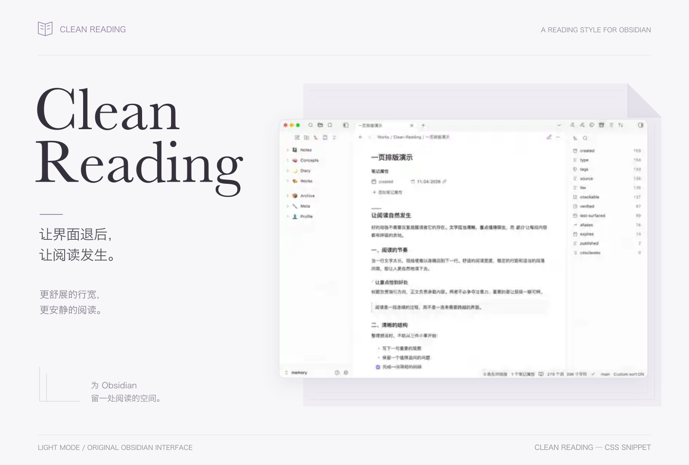
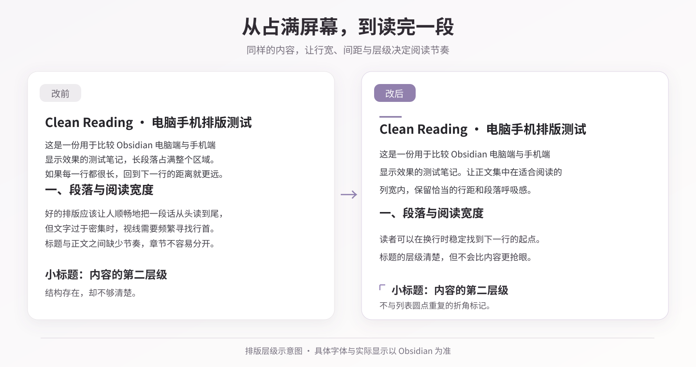
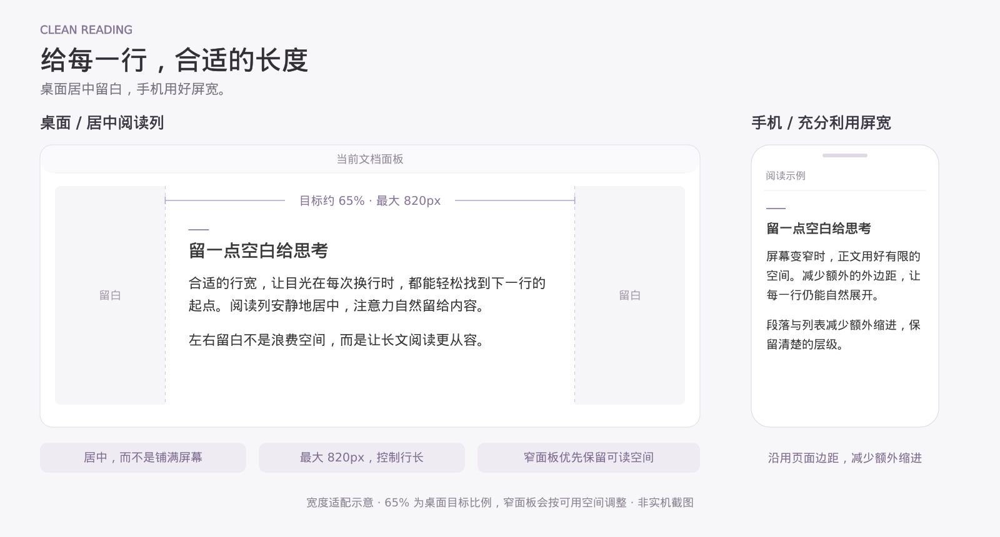
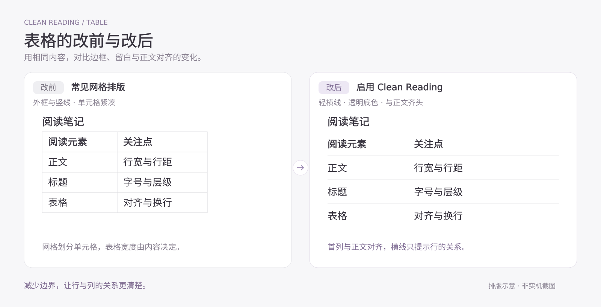
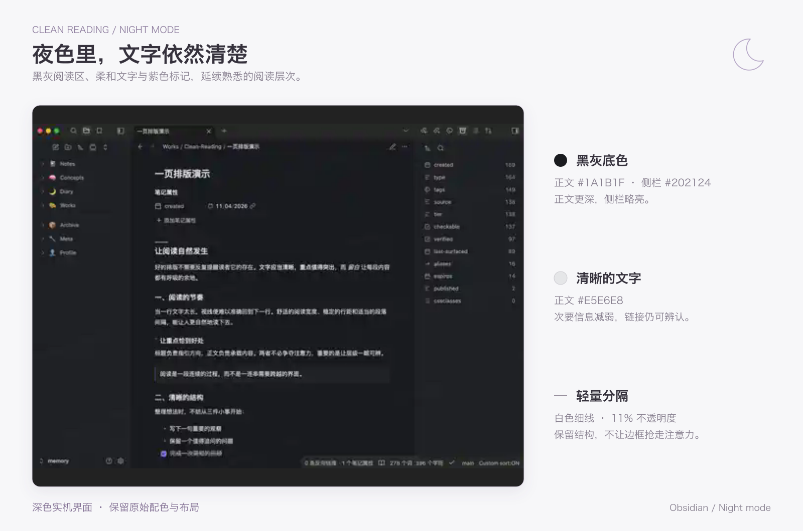
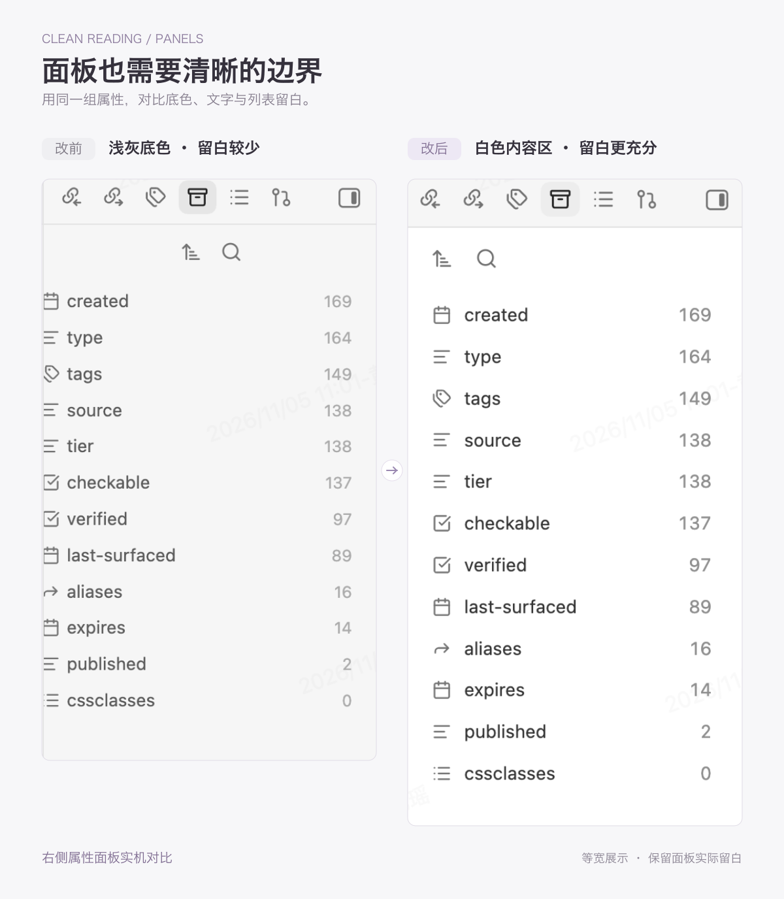

# Clean Reading

**让界面退后，让阅读发生。**

Clean Reading 是一份以 Obsidian 长文阅读为中心的 CSS 样式片段。它让文字成为主角：正文舒展，标题克制，颜色只在有信息价值的地方出现；浅色与深色遵循同一套阅读逻辑。

此外，它也会调整工作区的配色与界面字体，以及设置窗口、文件浏览器、搜索结果和部分 Git 插件界面的视觉层次。



## 主要特点

- **舒展的阅读列**：桌面正文以面板宽度约 65% 为目标居中，最大 820px；手机端减少额外留白。
- **克制的内容层级**：六级标题有各自的轻量标记，链接、列表与段落保持清晰的阅读节奏。
- **更安静的表格与引用**：表格以浅横线帮助比较，普通引用与 Callout 各有明确的视觉职责。
- **一致的明暗界面**：从正文到左右侧栏、设置窗口，都以中性的灰阶突出内容。
- **一个 CSS 文件即可使用**：兼顾阅读模式与实时预览，不附带字体，也不需要额外插件。

[安装](#安装) · [设计取舍](#设计取舍)

### 阅读排版：改前与改后



*相同文案的排版对比示意；改前样式会随主题而异。*

## 安装

### 手动安装

1. 下载 [`clean-reading.css`](clean-reading.css)。
2. 将文件放入 Obsidian 笔记库的 `.obsidian/snippets/` 目录。
3. 在 **设置 → 外观 → CSS 样式代码片段** 中刷新列表，开启 `clean-reading`。

Clean Reading 会调整正文排版，也会覆盖部分工作区与设置窗口的样式。建议不要同时启用另一套主要负责相同区域的 CSS 片段，以免互相覆盖。关闭 Clean Reading 即可停用效果，笔记内容不会被修改。

<details>
<summary>使用 AI 辅助安装（需要本地文件访问能力）</summary>

如果 AI 工具能够访问本地文件，可以将以下指令交给它，并指定目标 Obsidian 笔记库：

```text
请帮我安装 Clean Reading 这份 Obsidian CSS 样式片段：
https://github.com/jadecoltrane/clean-reading/blob/main/clean-reading.css

先确认我指定的笔记库路径。将仓库 main 分支中的 clean-reading.css
放到该笔记库的 .obsidian/snippets/clean-reading.css。
如果已有同名文件，请先备份再替换；不要修改我的笔记或其他 CSS 片段。
完成后告诉我如何在 Obsidian 的「设置 → 外观 → CSS 样式代码片段」中
刷新并启用它。若你无法读取或写入本地文件，请说明限制，
不要声称已经安装。
```

不具备本地文件访问权限的聊天 AI 可以解释安装步骤，但不能替你操作电脑。

</details>

## 设计取舍

### 1. 阅读宽度

影响长文阅读节奏的一个重要变量，是**视线每次折返的距离**。行太长，读完一行后需要重新寻找下一行的起点；行太窄，频繁换行又会切碎句子的节奏。适当的阅读宽度，让目光有稳定、可预期的移动范围。

桌面阅读列以当前面板宽度的约 **65%** 为目标居中，最大 **820px**；窄面板优先保留可读空间。手机端沿用页面边距，减少额外缩进。



*桌面与手机阅读宽度示意。*

正文字号跟随 Obsidian 设置（CSS 中的 **15px 只是回退值**，也可用 `--cr-body-font-size` 自定义）；默认采用 **400 字重、1.8 倍行距**，加粗为 **500 字重**。段落间距约 **1.1em**，列表缩进相应收紧。

字体交给 Obsidian 的正文字体设置。链接以细点状下划线提示可点击性：内链使用主题强调色，外链采用稳定的蓝色。**排版负责建立节奏，而不是替读者决定字体。**

### 2. 标题

标题的职责是回答“我读到哪里了”。层级通过字号、字重、留白与轻量标记区分，让章节转换清楚，却不过度打断阅读。

H1 用顶部短线起笔；H2 只靠文字与留白提示章节；H3 到 H6 则依次使用浅色折角、短底线、浅竖线与更柔和的文字颜色。不同标记承担不同职责，也避免与列表圆点混淆。


### 3. 表格

表格的阅读顺序是先定位列，再沿行比较。密集外框、竖线和交替底色容易让简单的对照变得零碎。

这里保留**轻量横线**提示行的位置，让表头、数据和正文共享干净的纸面。表格与阅读列对齐；手机端允许较长的中文、链接和代码在单元格内换行。



*表格排版对比示意，展示边框、留白与对齐方式的变化。*

### 4. 夜间模式

浅色模式使用白色正文区域和中性灰白界面。深色模式的正文背景为 **`#1a1b1f`**，左右侧栏为略亮的 **`#202124`**，正文文字使用 **`#e5e6e8`**；低对比度分隔线减轻整页的亮度负担。

**变化的是光照条件，不变的是信息秩序。** 正文保持清晰，标题不过分突出，链接仍可辨认；普通引用保留细线，Callout 沿用主题的语义色。阅读模式与实时预览遵循同样的排版原则。



*夜间模式实机截图与配色标注。*

### 5. 面板与侧边栏

正文之外的界面也会影响阅读。**内容区域保持清楚，灰阶负责区分导航与操作层**，不必依赖密集分割线。

浅色模式下，左侧文件区采用 **`#fcfcfc`**，部分顶栏和操作区域使用 **`#f4f4f4`**，右侧内容面板保持白色；选中文件以 **`#eff0f0`** 柔和提示。设置窗口同样采用左灰右白的分区；深色模式则以相邻的黑灰层次延续这一结构。

**侧栏、标签页、状态栏与设置等界面文字比正文字号小 1px**，操作图标保留原有尺寸，选中项使用轻量圆角。右侧属性面板避免双重缩进；Git 工具栏在空间有限时尽量让按钮成行，并允许横向滚动。**侧栏应该容易操作，却不必与正在阅读的文字争夺注意力。**



*右侧属性面板实机对比：左为改前，右为改后。*

---

*图片说明：封面、夜间模式和右侧属性面板对比使用实机截图；阅读排版、阅读宽度、标题层级与表格对比为设计示意。具体效果会随 Obsidian 版本、主题、字体和设备有所变化。*

[MIT License](LICENSE)
