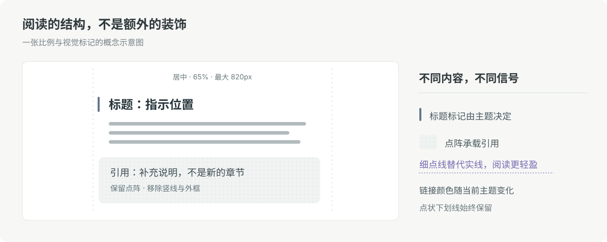

# Clean Reading

**一份适用于 Obsidian 默认主题与第三方主题的克制阅读增强 CSS。**

不必切换到指定主题。Clean Reading 兼顾长文阅读和统一界面：调整正文宽度、段落、标题、列表、引用、Callout、表格与链接，配合**中性浅色界面和黑灰夜间模式**。一份 CSS，全部生效。

[下载 CSS](clean-reading.css) · [安装说明](#安装) · [设计细节](#具体改了什么)

*这张图是原创的版式结构示意，不是 Obsidian 实机截图。*

## 为什么这样设计？

### 01｜控制阅读列的宽度

电脑端正文保持水平居中，以编辑面板宽度的 **65%** 为目标，最大 **820px**，窄窗口自动适应。约 **1.8 倍行距**，适度段间留白，减少一行过长时视线返回下一行的负担。

### 02｜把重点留给真正重要的字

正文约 **400** 字重，局部强调约 **500**，标题约 **500–550**。通过字号和上下间距区分层级，而不是让整篇笔记都显得很重。

### 03｜标题是结构，引用是补充

我不希望引用块与 Callout 和标题重复使用左侧竖线。有些主题用竖线提示章节位置，若引用也有相同标记，两种信息容易混淆。

Clean Reading 用逐级减弱的细节区分六级标题：**H1 主题色细竖线、H2 淡底线、H3 小圆点、H4 短底线、H5 浅竖线、H6 柔和次级文字**。不依赖大幅加粗。引用与 Callout 都采用**极浅的中性灰背景、主题色混入 15% 灰调的细点阵、8px 圆角**，取消左竖线和外框。

### 04｜链接跟随主题色，保持轻盈的点状下划线

把连续的实线下划线改成**细点状虚线**，保留可点击的提示，同时让长段落少一些连续横线。内外链的颜色改为**沿用当前主题的链接颜色**，不再固定为蓝色；外链图标仍沿用当前主题。

链接分别读取 Obsidian 的 `--link-color`、`--link-external-color` 和悬停颜色变量，因而会随主题及明暗模式变化；点状下划线、悬停和键盘焦点样式依然保留。若主题设置的链接颜色过浅，应从主题本身调整。

## 具体改了什么

| 元素 | 调整 |
| --- | --- |
| 电脑正文 | 65% 居中阅读列、最大 820px，兼顾阅读模式和实时预览 |
| 正文节奏 | 默认 14px，约 1.8 倍行距、1.1em 段后间距 |
| 标题与加粗 | H1–H6 逐级减弱的轻标记（竖线／底线／小圆点／浅色文字）；正文约 400、重点约 500 |
| 列表 | 电脑仍保持约 0.65em；手机调整为约 0.8em，并只做轻微容器偏移，避免项目符号被裁切 |
| 引用 / Callout | 引用与 Callout 共用极浅灰底、主题色混入 15% 中性灰的低饱和点阵、无边框及紧凑末段；Note／Abstract／Quote／Example 图标中性灰，Info／Tip 蓝、Warning 黄橙色 `#D07932`、Danger 红、Success 绿 |
| 表格 | 少格线、浅横线、轻表头；手机尽量换行而不是横向溢出 |
| 内外链 | 跟随当前主题的链接颜色，保留细点线、悬停和键盘焦点 |
| 浅色界面 | 温和的灰白背景、中性文字与轻分隔线，尽量不改变个人组件布局 |
| 深色模式 | 中性黑灰背景、浅灰正文、柔和分隔线和灰度点阵 |
| 补充组件 | 行内代码、代码块、任务框、标签、分隔线、脚注与嵌入笔记统一轻量样式 |

## 中性浅色界面与黑灰夜间模式（已内置）

亮色模式现在使用**温和灰白背景、清晰的中性正文和低对比度分隔线**。与黑灰夜间模式配成一组，但保留 Obsidian 的交互强调色和用户自己安装的组件。

有些主题的暗色背景受主题强调色影响，会明显偏紫或偏蓝。我更喜欢普通、中性的黑灰，因此把夜间配色**直接整合在同一个 CSS 里**，不再需要第二个文件。

切换 Obsidian 到**深色模式**时，正文背景使用 `#202124`，侧栏与其他底层区域使用更深的灰黑；浅灰文字、低对比度分隔线和灰度点阵让整体更安静。

**浅色与深色模式都会调整 Obsidian 的基础配色**，包括侧边栏和背景；个人 Home 等依赖主题变量的界面也可能跟着改变。Clean Reading 不改动其他 CSS 片段，但不承诺与所有第三方主题的每个界面都完全一致。

## 安装

无需安装指定主题；Obsidian 默认主题和第三方主题都可以使用。

1. 下载 [`clean-reading.css`](clean-reading.css)。
2. 放进笔记库的 `.obsidian/snippets/` 文件夹。
3. 打开 **设置 → 外观 → CSS 代码片段**，刷新并开启 **clean-reading**。

正文增强和黑灰夜间模式都在同一份文件中，**只需开启这一项**。深色配色跟随 Obsidian 的深色模式自动生效。

**旧版本升级：** 如果以前启用的是 `border-reading.css` 与 `neutral-dark.css`，请先关闭旧片段，再启用新的 `clean-reading.css`，避免样式叠加。

## 适用范围

Clean Reading 主要修改常规 Markdown 笔记的阅读排版，并为整个 Obsidian 提供一套浅色／深色中性基础配色。它不要求特定主题，不附带字体，也无需额外插件。个别第三方主题的自定义布局和高优先级规则仍可能需要针对性适配。

要恢复原主题外观，只需关闭这个 CSS 片段。

设计参考：[Baymard · 行宽与阅读](https://baymard.com/research-articles/line-length-readability) · [W3C · 文字间距适配](https://www.w3.org/WAI/WCAG22/Understanding/text-spacing)。

[MIT License](LICENSE) · 非 Obsidian 官方项目。
