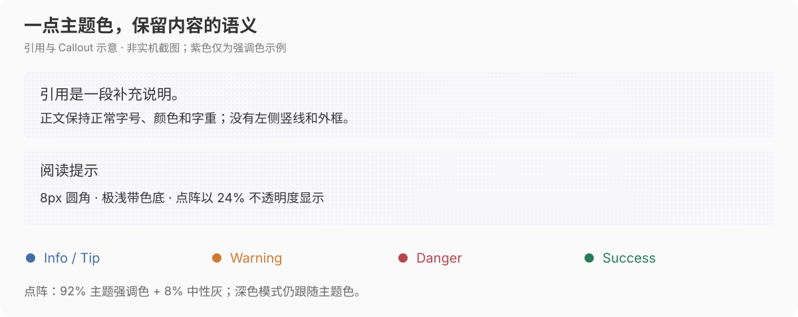
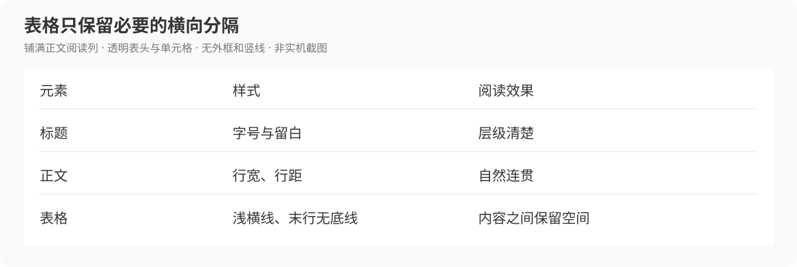

# Clean Reading

**给 Obsidian 的一份克制阅读增强 CSS。**

默认 15px 正文、居中的阅读列、轻量标题、主题色点阵引用，以及配套的白灰界面与黑灰夜间模式。不附带字体，无需额外插件；不要求切换到指定主题。

[下载 CSS](clean-reading.css) · [安装](#安装) · [阅读排版](#阅读排版) · [界面与侧边栏](#界面与侧边栏) · [测试笔记](examples/电脑手机排版测试.md)


*以下图片根据当前 CSS 参数绘制，用于说明比例、颜色和组件结构，不是 Obsidian 实机截图，也不是手机效果预览。图中紫色仅为主题强调色示例，实际颜色和字体跟随你的设置。*

## 安装

1. 下载 [`clean-reading.css`](clean-reading.css)，保存原始 CSS 文件。
2. 放入笔记库的 `.obsidian/snippets/` 文件夹。
3. 打开 **设置 → 外观 → CSS 样式代码片段**，刷新列表并开启 **clean-reading**。

阅读排版和明暗配色都在这一份文件里。若正在使用 `border-reading.css`、`neutral-dark.css` 或其他整套阅读样式，请先关闭重叠片段，避免字号、标题和配色互相覆盖。关闭 Clean Reading 即可撤销本片段的效果，不会改写笔记内容。

## 阅读排版

### 正文轻一点，层级清楚一点

正文默认 **15px、400 字重**，加粗文字约 **500**；使用 Obsidian 的正文字体设置，不强制安装或指定字体。约 **1.8 倍行距**与 **1.1em 段后间距**让连续中文保持适当留白。

一级标题使用**正常文字颜色**，字号始终是二级标题的 **108%**，不使用主题色、左侧竖线或底线。二级标题也不加底线，靠字号、字重和上下留白区分章节；笔记原有的 `---` 分隔线仍保留。

| 层级 | 当前样式 | 电脑字号（相对正文） |
| --- | --- | --- |
| H1 | 常规文字色、无竖线和底线，550 字重 | 1.296em（H2 × 1.08） |
| H2 | 简洁文字与留白，无底线，550 字重 | 1.20em |
| H3 | 小圆点标记，500 字重 | 1.08em |
| H4 | 短底线，500 字重 | 1.04em |
| H5 | 浅竖线，500 字重 | 1em |
| H6 | 柔和次级文字，500 字重 | 0.96em |

手机端 H2 为 1.16em，H1 仍为 H2 的 108%，H3 为 1.07em。

### 阅读列与列表

电脑端正文以编辑面板宽度的 **65%** 为目标居中，最大 **820px**；面板空间足够时保留至少 **600px** 的阅读宽度，窄窗口以可用宽度为限。阅读模式和实时预览均有对应规则。

电脑列表缩进约 0.65em；手机端使用约 0.8em 的层级缩进，并轻微校正顶层列表位置。手机正文只补少量横向留白，减少多层缩进挤占可读区域。

### 引用与 Callout：留一点主题色



引用与 Callout 共用 **8px 圆角、极浅带色底和细点阵**，移除左侧竖线与外框。正文保持正常字号、颜色和字重，末段不额外留下大块空白。

点阵颜色取 **92% 主题强调色 + 8% 中性灰**，再以 **24% 不透明度**显示；背景只带极少量主题色。浅色、深色模式都会跟随当前强调色，**深色点阵不是固定灰色**。

语义色主要用于图标及部分标题，避免整张卡片被染成高饱和彩色：

| 类型 | 浅色语义色 | 深色语义色 |
| --- | --- | --- |
| Note / Abstract / Summary / Quote / Example 等 | 中性灰图标 | 中性灰图标 |
| Info / Tip / Hint | 蓝 `#436DA4` | 蓝 `#8AB4FF` |
| Warning / Caution / Attention | 黄橙 `#D07932` | 暖黄 `#F0B84D` |
| Danger / Error / Failure | 红 `#B3484E` | 红 `#E68E93` |
| Success / Check / Done | 绿 `#287B59` | 绿 `#88C6A2` |

### 链接与表格

内外链分别沿用主题的链接颜色与悬停颜色，不固定为蓝色，也不强制两者同色。细点状下划线、悬停反馈、键盘焦点提示保留，外链图标交给主题处理。



表格铺满正文阅读列，表头与单元格透明，只保留浅横线；没有外框、竖线或交替底色，末行不再加底线。手机端固定表格宽度并允许长文字、链接与代码换行。

行内代码、代码块、任务框、标签、脚注、分隔线和嵌入笔记也有轻量样式；代码继续使用等宽字体。

## 界面与侧边栏

Clean Reading 也会调整 Obsidian 的基础界面配色，不只是正文样式。

| 区域 | 浅色模式的当前设置 |
| --- | --- |
| 正文纸面 / 右侧面板 | 白色 `#FFFFFF` |
| 左侧文件栏 | 近白 `#FCFCFC` |
| 顶部标签栏 | 浅灰 `#F4F4F4` |
| 设置窗口及其菜单背景 | 近白 `#FBFBFB` |
| 文件列表、设置菜单选中项 | `#EFF0F0`，统一 8px 圆角 |
| 左右侧边栏默认字号 | 15px；文件名沿用正文字体、400 字重，选中时不额外加粗 |
| 设置菜单字重 | 400 |

文件列表通过行内留白增加间距。右侧 Git 操作图标与顶部标签图标共用尺寸，操作按钮保持紧凑；**无需安装 Git 插件**，相关规则仅在对应面板存在时生效。

切到 Obsidian **深色模式**时，正文背景为 `#202124`，侧栏使用更深的灰黑，配合浅灰文字和低对比度分隔线；链接和点阵仍保留主题颜色。无需另开夜间模式片段。

## 自定义正文字号

默认值为 15px。需要其他字号时，可以在单独的自定义片段中设置：

```css
body {
  --cr-body-font-size: 16px;
}
```

这会调整普通笔记正文和侧边栏文件名；其他界面文字的默认字号仍为 15px。字体本身通过 **设置 → 外观 → 正文字体**选择。

## 适用范围与测试

面向 Obsidian 默认主题及第三方主题，覆盖常规 Markdown 笔记的阅读模式与实时预览。第三方主题的高优先级规则可能保留自己的装饰或布局，因此不承诺所有主题的每个细节完全一致。

带 `.workbench` 的个人 Home 页面不套用常规正文规则；但全局明暗配色仍可能影响依赖主题变量的 Home 或其他插件界面。项目不附带私人工作台、文件树分组或个人主题配置。

可以把 [电脑手机排版测试](examples/电脑手机排版测试.md) 放进自己的笔记库，对照段落、列表、链接、Callout 与表格；另有简短的 [阅读排版演示](examples/阅读排版演示.md)。这些是公开示例，不含个人资料。本文配图是样式示意；实际阅读模式、实时预览、手机与深色效果请在自己的设备上对照查看。

[MIT License](LICENSE) · 非 Obsidian 官方项目。
