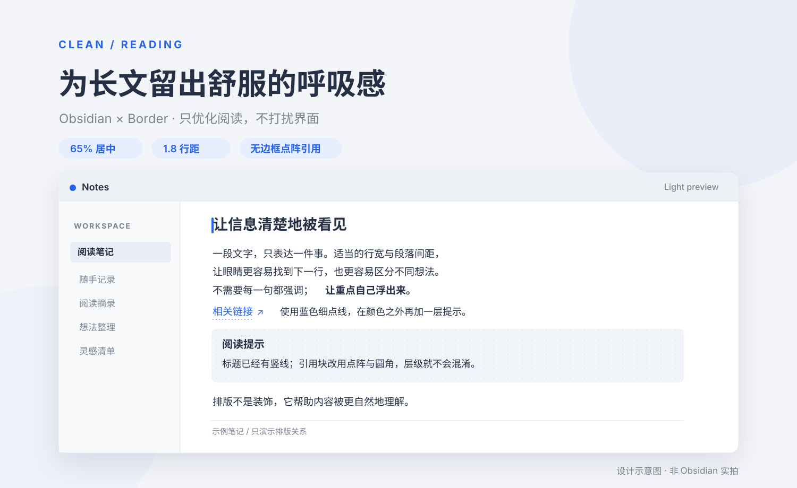
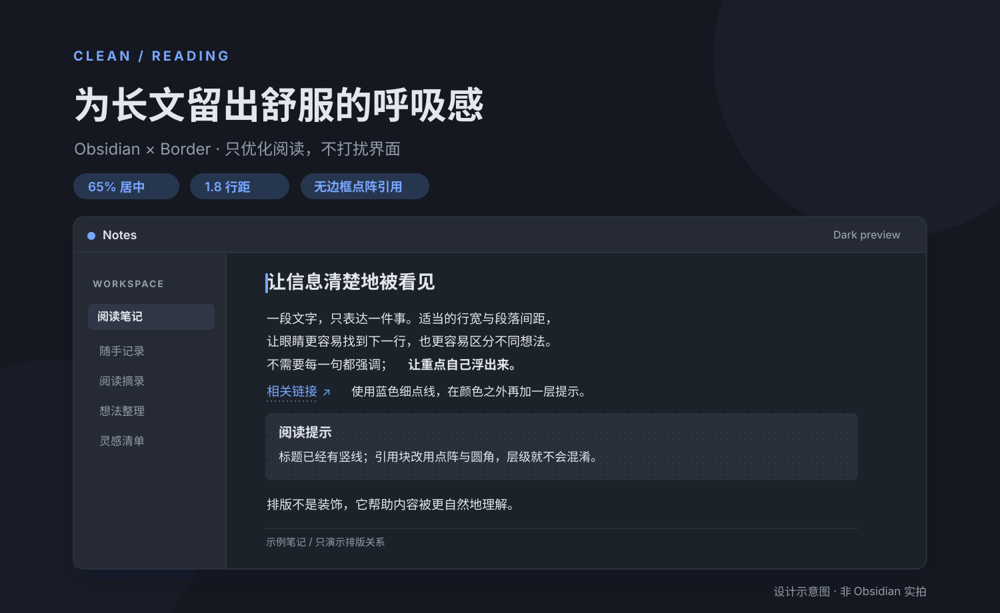
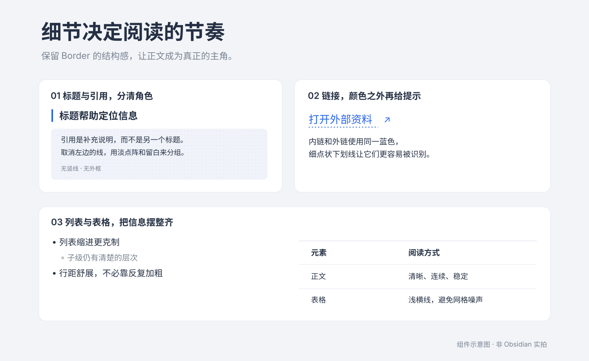

# Clean Reading

**为 Obsidian 的 [Border 主题](https://github.com/Akifyss/obsidian-border)做的一点长文阅读增强。**

没有新的复杂设置，也不改变你的 Home 页、侧边栏和工具栏。只用一份 CSS，让标题、段落、引用、列表与表格之间的关系更清楚。

[下载 CSS](https://raw.githubusercontent.com/jadecoltrane/clean-reading/main/border-reading.css) · [看看演示笔记](examples/阅读排版演示.md) · [安装说明](#安装只要一分钟)





> **关于图片：** 上面和下方都是原创的版式**概念示意图，不是 Obsidian 实机截图**。文字、背景和组件效果会随 Obsidian 版本、Border 设置与系统环境变化。暗色模式的界面配色仍由 Border 主题决定，本项目不会把界面改成示意图里的颜色。

## 先看看细节



| 改动 | 解决的问题 |
| --- | --- |
| **居中的阅读列** | 电脑端以编辑区域约 **65%** 为目标，**最大 820px**；窄窗口自动适配，避免长行扫视吃力 |
| **更有节制的字重** | 正文 **400**、强调 **500**、标题约 **500–550**；不用满篇重黑字制造层级 |
| **更舒展的段落** | 约 **1.8 倍行距**，用段间距和标题留白分清一件事与下一件事 |
| **更浅的列表缩进** | 电脑端约 **0.9em**，手机端约 **0.95em**，减少正文不断往右跑的问题 |
| **点阵引用 / Callout** | 保留圆角和细密浅点阵，移除左侧竖线及外围边框；内部正文与外面一致 |
| **简洁的表格** | 减少竖向格线，以浅横线组织信息；手机端尽量自然换行 |
| **一致的超链接** | 内外链统一蓝色 `#2563eb`，保留细点状下划线和 Border 原生外链标识 |

### 为什么引用块不再有左边竖线？

这是这次最重要的一处层级取舍。

**Border 的标题可以用竖线帮助定位章节。** 如果引用块与 Callout 也沿用同一条左侧竖线，读者容易把“补充说明”和“章节标题”看成相同层级。所以这里把竖线留给标题，把**淡点阵、轻背景、圆角与留白**留给引用内容。

目的不是少画一条线，而是让**不同作用的内容使用不同的视觉语言**。

## 安装，只要一分钟

**前提：** 已在 Obsidian 中启用 [Border 主题](https://github.com/Akifyss/obsidian-border)。Clean Reading 是 CSS 代码片段，**不是独立主题**，也不需要额外安装插件。

1. [下载 `border-reading.css`](https://raw.githubusercontent.com/jadecoltrane/clean-reading/main/border-reading.css)。
2. 放到你的 Obsidian 仓库中：`<仓库>/.obsidian/snippets/border-reading.css`。
3. 打开 **设置 → 外观 → CSS 代码片段**，刷新列表并开启 **border-reading**。

如果你已经安装了其他修改正文排版的片段（例如旧的 `clean-reading.css`），先关闭冲突的片段，不要叠加使用。

### 也可以交给能访问本地文件的 AI Agent

复制下面这段话给支持本地文件操作的工具：

```text
请给我的 Obsidian 安装 Clean Reading 正文增强 CSS。
项目地址：https://github.com/jadecoltrane/clean-reading
从仓库根目录获取 border-reading.css，
安装到当前仓库的 .obsidian/snippets/ 下，并在 Obsidian 中启用。
先备份同名文件，检查是否已有冲突的正文 CSS；
不要覆盖我的笔记、Home 页面、主题或其他设置。
安装后检查阅读模式与实时预览，并告诉我实际验证结果。
如果无法操作本地文件，请明确告诉我需要手动完成的步骤。
```

## 用一篇演示笔记感受它

打开 [**阅读排版演示.md**](examples/阅读排版演示.md)，可以一次看到标题、段落、加粗、内外链、嵌套列表、任务、引用、Callout 与表格。

想测试**可点开的内部链接**，也把旁边的 [示例链接目标.md](examples/示例链接目标.md) 放进同一个 Obsidian 文件夹。

## 这些设计有什么依据？

**限制行宽，是在帮眼睛换行。** 行太长，视线返回下一行开头的距离也更长；行太短，又会频繁换行。网页排版中常见的行长建议主要基于拉丁文字，不能直接换算为固定的中文字符数。因此 65% 与 820px 是一组可用的设计取舍，而不是通用的最佳答案。参见 [Baymard 的行长分析](https://baymard.com/research-articles/line-length-readability)。

**层级不必只靠加粗。** 标题的上下留白、列表缩进和段间距，也能表达“哪一段属于同一个话题”。这与视觉设计中的**接近性原则**一致：距离近的元素更容易被看成一个整体。

**链接不能只靠颜色识别。** 蓝色细点线多提供一条辨认线索；让正文、表格和引用文字维持清楚的对比，比一味调淡更重要。可参考 [W3C 对文字间距适配的说明](https://www.w3.org/WAI/WCAG22/Understanding/text-spacing)。

## 使用范围和注意事项

- **包含：** 普通 Markdown 正文、标题、加粗、段落、列表、引用、Callout、表格、内外链的 CSS 增强；覆盖阅读模式及实时预览的相关元素。
- **不包含：** Home 工作台、侧边栏、文件树、标签栏、滚动条、个性化深色背景、个人数据或第三方素材。
- **亮色与暗色：** 正文样式随当前 Border 主题工作，整体背景仍由 Border 管理。
- **适配说明：** 当前代码按 Obsidian / Border 的常见 DOM 结构编写，尚未在所有桌面平台和实体手机上逐一实测；主题和插件更新可能改变效果。
- **取消安装：** 在 Obsidian 的 CSS 代码片段设置中关闭 `border-reading`，或移除对应文件即可恢复主题原本的正文样式。

项目采用 [MIT License](LICENSE)。这是基于 Border 的个人扩展项目，**并非 Border 或 Obsidian 官方作品**。感谢 [Border 主题作者](https://github.com/Akifyss/obsidian-border) 提供基础主题。

