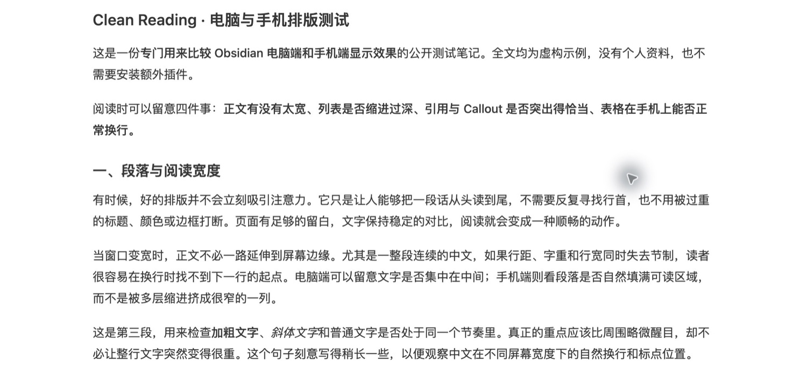

# 留一点空白给思考

*一篇关于阅读、留白与注意力的公开示例文章*

有时，我们打开一篇文章，只想安静地读完它。屏幕已经足够明亮，文字也已经足够多；真正难得的，反而是一种不必时刻提醒自己“正在使用软件”的阅读感受。

好的排版不是把内容装饰得更显眼，而是让人自然地找到下一行、下一段和下一层意思。在这里，**重点值得被看见**，但不需要每句话都变成重点；*语气可以轻一些*，也依然能够被听见。

> 阅读不只是看见文字，也包括在文字之间保留思考的余地。

## 一、读完一行，再读下一行

当一段话横跨整个窗口，视线每次换行都要走很远。屏幕越大，这种距离未必越舒适。比起让内容占满所有空间，留出适当的边缘，往往更容易让注意力停留在正文里。

对于连续的中文段落，**行长、行距和段落间距需要一起考虑**。行距太紧时，行与行容易粘在一起；段落距离太大时，论述又会被分割成互不相干的片段。理想的节奏不在某个孤立的数字里，而在于从上一句到下一句是否顺畅。

### 一行文字的边界

合适的阅读列能够让文字形成稳定的形状。窗口变宽时，正文不必无限延长；窗口变窄时，文字也不应该被层层缩进挤成细条。这种约束看似减少了可用空间，却换来了更容易追踪的阅读路径。

#### 段落：留一次自然的停顿

段落的空白不是缺失的内容。它像说话时短暂的换气，让读者知道：一个意思已经说完，接下来会进入新的方向。

##### 强调：只给真正重要的词

加粗适合强调一个判断，斜体适合表现一种语气。两者都很好用，但不需要同时覆盖整句。过度强调会产生一种奇怪的结果：**所有词都很响，便没有词真正突出**。

###### 更轻的层级，也应该能够被找到

小标题不一定需要醒目的颜色或复杂的图案。只要层级清楚，读者就能知道自己正处于文章的什么位置；哪怕这里的标题比前面更轻，也仍然属于同一个结构。

## 二、让结构成为路标

文章中有些内容适合一口气读完，也有些内容值得暂时停下来查看。列表、任务项与引用的意义，不是让页面变得热闹，而是帮助不同的信息使用不同的表达方式。

假如想整理一次短暂的阅读时光，可以只保留三件小事：

1. 选择一段真正想读的内容，而不是继续收集十篇待读文章。
2. 读完后写下一句自己的理解，不急着给它起一个漂亮的标题。
3. 过一段时间再回来，看看那句话是否依然成立。

有些想法可以更松散地放在项目列表里：

- 一句话的观察
- 一个暂时没有答案的问题
  - 可能的解释
  - 还需要核对的地方
- 一段值得再次阅读的文字

而需要行动的部分，则适合成为任务：

- [x] 留下今天最想记住的一句话
- [ ] 查证其中尚不确定的事实
- [ ] 找一个安静的时间重新阅读

> 我们不必把每一次阅读都变成任务。
>
> 有时候，**记住一种感受**，就已经是很好的收获。

## 三、提醒应该各有分寸

不是所有信息都需要同样的音量。普通旁注可以轻，事实提醒应当清楚；真正涉及风险的内容，才值得使用更强烈的信号。下面的区块展示同一篇笔记里不同类型的信息如何并存。

> [!note] 一个普通的旁注
> 有些想法还不成熟，不必急着写成结论。把它们暂时放在这里就好。

> [!abstract] 内容摘要
> 一篇文章的核心可以很短：让结构帮助理解，让装饰退居其次。

> [!example] 举个小例子
> 把“准备开始阅读”改成“打开文章，读完前两段”，行动就有了清楚的起点。

> [!info] 补充信息
> 阅读模式适合连续浏览；实时预览则方便边看边改。两种视图都值得检查。

> [!tip] 一个温和的建议
> 如果一段文字特别难读，先检查句子是否过长，再考虑调整样式。

> [!warning] 需要留意
> 强调色越多，越可能失去强调的作用。重要信息应该被辨认，而不是被颜色淹没。

> [!success] 已完成
> 今天没有读完所有材料，但已经理解了一段真正重要的内容。

> [!danger] 不要忽略
> 对尚未核实的信息，不要因为它排版精美，就误以为它一定可靠。

这些区块属于文章的辅助层。**标题仍然是文字，语义色只负责提供线索**；读者应当能轻松返回正文，而不是被一张张卡片截断。

## 四、用表格比较，而不是用表格制造边框

当信息需要逐项对照时，表格往往比长句更直接。但表格的重点在于关系，不在于画出多少条线。

| 阅读情境 | 更需要什么 | 可以少一点什么 |
| --- | --- | --- |
| 长篇文章 | 稳定的行宽、清楚的段落节奏 | 过多的强调和装饰 |
| 随手记录 | 容易扫视的标题与列表 | 复杂的页面结构 |
| 资料整理 | 清晰的对齐、必要的链接与备注 | 密集的表格边框 |
| 手机阅读 | 自然换行、适度留白、足够的点击空间 | 为桌面设计的过宽表格 |

当屏幕变窄时，请留意这一格较长的说明能否自然换行，而不是把整张表格向右撑出屏幕：**内容应该适应容器，不能反过来要求读者迁就布局。**

## 五、文字里的细节

一些小元素往往最能暴露排版是否协调：例如一段 `inline code` 能否融入中文句子；[Obsidian 官网](https://obsidian.md/) 这样的外部链接是否足够容易辨认；或者一段 ~~已经不再准确的表述~~ 能否自然地划去而不妨碍阅读。

下面是一小段 Markdown 原文。它不是必须照着执行的设置，只是用来观察代码块的字体、边距和背景：

```markdown
> 写下一句想留下的话。

- 一个观察
- 一个问题
- 一个仍待验证的想法
```

如果你把这篇示例放进 Obsidian，还可以观察脚注[^1]、中英文混排、括号（以及 English words）和各种标点在行尾的表现。它们不一定引人注目，却共同决定一篇文章读起来是否顺手。

[^1]: 这是一条示例脚注，用于观察正文中的标记和文末的补充说明如何相互呼应。

---

## 六、把注意力还给文章

清晰的标题、合适的段距、柔和的提示、能够换行的表格，这些都是阅读的辅助。它们各自有用，却不该成为文章真正的主角。

当读者读到这里，最理想的结果不是记住了某条 CSS 规则，而是记住了文章里的一句话。**让界面退后，让阅读发生。**



*真实界面截图用于观察阅读列与留白；本文其余文字均为公开示例内容，不包含个人资料。*

---

*这是一篇供 [Clean Reading](../README.md) 用户体验排版的公开 Markdown 示例。可在 Obsidian 的阅读模式、实时预览和手机端打开对比。GitHub 的 Markdown 预览不完全等同于 Obsidian，尤其是 Callout 的呈现。*
